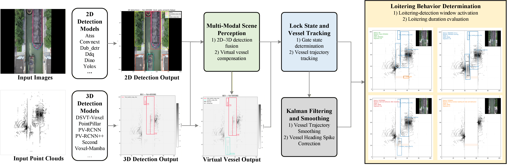

# Loitering-Vessel-Early-Warning 🚢

This project focuses on **early warning of loitering vessels in sea-connected locks**, aiming to improve navigation safety and operational efficiency in intelligent waterway systems. 
In lock-related monitoring areas, vessel staying behavior is strongly affected by **gate operation, chamber occupancy, transit direction, and dense traffic interactions**, which makes reliable warning difficult when using frame-wise detection alone.

To address these challenges, this project builds a **temporally coherent loitering-vessel warning framework** based on **multi-modal back-end fusion**, integrating **2D image detections**, **3D LiDAR detections**, **gate-state analysis**, **trajectory association**, and **temporal refinement**. 
Compared with conventional rule-based or single-frame methods, the proposed framework is designed to provide **more robust loitering recognition**, **fewer false alarms**, and **better temporal consistency** in complex lock environments.

**Highlights**: 
* Multi-modal back-end fusion** of image-based 2D detections and LiDAR-based 3D detections
* Temporally coherent scene understanding** for lock operation analysis
* Gate-state inference** based on lock-gate observations and temporal trends
* Trajectory-based vessel behavior reasoning** for entry, exit, and staying analysis
* Loitering early warning** with reduced false alarms through temporal refinement
* Support for virtual vessel compensation** and Kalman-based smoothing in challenging scenes


## Overview
- [Changelog](#changelog)
- [Model Zoo](#model-zoo)
- [Installation](#installation)
- [Getting Started](#GETTING-STARTED)
- [Citation](#citation)


## Changelog
[2026-04-10] `Loitering-Vessel-Early-Warning` v0.1.0 is released. 


## Introduction
We propose a **temporally coherent loitering-vessel warning framework** that integrates **2D image detection** and **3D LiDAR point cloud detection**, combined with **lock gate state analysis**, **trajectory association**, and **temporal refinement**, to achieve accurate and reliable early warning of loitering vessels in sea-connected locks.

Main contributions:
- ✅ Fusion of **2D image detections** and **3D LiDAR detections** for robust multimodal scene perception.
- ✅ **Lock gate state analysis** to model the temporal evolution of gate operation in monitored lock scenes.
- ✅ **Trajectory-based vessel behavior reasoning** for identifying entry, exit, and staying patterns within the lock chamber.
- ✅ **Temporally coherent loitering warning** with Kalman-based smoothing and heading refinement to reduce false alarms caused by short-term perception noise.

- DATA at：[Coco_TROUT_data](https://drive.google.com/file/d/1mFQS-TTOR1sSjfPCuIeryK_LND2CLhk9/view?usp=sharing),  [PCDet_TROUT_data](https://drive.google.com/file/d/1JCClYd6egTm0AxXtW80L18AySgG45_og/view?usp=sharing).


<p align="center">
  
</p>


## Model Zoo

### No-Stop-Line Detection in Sea Locks Baselines
* All models are trained with GTX 4080 GPU and are available for download. 

| Group | Metric | Pre | KF | Improvement |
|------|------|----:|---:|------------:|
| Frame | Precision (%) | 99.27 | 99.48 | +0.21 |
| Frame | Recall (%) | 98.66 | 98.66 | +0.00 |
| Frame | F1 (%) | 98.96 | 99.07 | +0.10 |
| Event | Precision (%) | 87.88 | 93.55 | +5.67 |
| Event | Recall (%) | 100.00 | 100.00 | +0.00 |
| Event | F1 (%) | 93.55 | 96.67 | +3.12 |
| Event | Mean onset delay (frames) | 0.34 | 0.34 | +0.00 |
| Event | Mean sync IoU (%) | 96.22 | 96.22 | +0.00 |


## Installation

First ensure that has been installed mmdetection_trout environment, installation method please refer to [mmdetection_trout_github](https://github.com/serendipitylxd/mmdetection_trout), to ensure that has been installed PCDet_trout environment, Please refer to the [PCDet_trout_github](https://github.com/serendipitylxd/Hydro3DNet) installation method
You can install mmdet and pcd in different conda environments.

## Getting Started

The checkpoint of the 2D model needs to be downloaded and placed in the corresponding path

[atss_trout_261M](https://drive.google.com/file/d/1EhawdW_1tQQAZ-QrreHErOwNxLKmphuP/view?usp=sharing)

[convnext_trout_1125M](https://drive.google.com/file/d/1FyL_ZEuqRl9GxsvgX6Y6Guj0ezOuLvf6/view?usp=sharing) 

[dab_detr_trout_541M](https://drive.google.com/file/d/1k98gA-4NNs8dHuR6qhw5dDHsvJ855uf_/view?usp=sharing)

[ddq_trout_621M](https://drive.google.com/file/d/1098VkIlZuPhmdg4TTM0XuN-t1I3Fb5tC/view?usp=sharing)

[dino_trout_600M](https://drive.google.com/file/d/19gbAcmZjLBu9h8PaDtQMqKo0zxPi_ksi/view?usp=sharing)

[yolox_trout_142M](https://drive.google.com/file/d/1EN7vk39We_iZeQZ0HCwR2M3NkxgN_xgi/view?usp=sharing)
```
No-stop-lines
├── mmdet_models
│   ├── checkpoint
│   │   │── atss.pth
│   │   │── convnext.pth
│   │   │── dab-detr.pth
│   │   │── ddq.pth
│   │   │── dino.pth
│   │   │── yolox.pth
```

The checkpoint of the 3D model needs to be downloaded and placed in the corresponding path

[dsvt_voxel_trout_99M](https://drive.google.com/file/d/1ogt1wMTLQ1vDvJhzAiHGpQztLJH6wF_9/view?usp=sharing)

[pointpillar_trout_58M](https://drive.google.com/file/d/18jLmXM-chjmL1iEtMOzgqvEXxqhz-Hee/view?usp=sharing) 

[pv_rcnn_trout_158M](https://drive.google.com/file/d/11ld6ZocQq39RsFXT_AO4-qH0Qg38XDxd/view?usp=sharing)

[pv_rcnn_plusplus_trout_169M](https://drive.google.com/file/d/1kCMnxVuFaLpKpMWynIiBbFY7-WKGXwyY/view?usp=sharing)

[second_trout_58M](https://drive.google.com/file/d/1jsgBfjvD0Aa7_ywrZR7-zrOrc_WK_Yjz/view?usp=sharing)

[voxel_mamba_trout_142M](https://drive.google.com/file/d/1j6-VIsT_YAJLACLVLMxmxSK5cilgEnfV/view?usp=sharing)
```
No-stop-lines
├── pcdet_models
│   ├── checkpoint
│   │   │── dsvt_voxel.pth
│   │   │── convnext.pth
│   │   │── pv_rcnn.pth
│   │   │── pv_rcnn_plusplus.pth
│   │   │── second.pth
│   │   │── voxel_mamba.pth
```

### How to use TROUT data sets for training and evaluation

Before running the code, you need to open **configs/config.yaml** and make relevant modifications according to the environment you have configured.

Run the loitering-vessel early-warning pipeline using the configuration file configs/config.yaml, and enable visualization output generation:

```shell
python scripts/loitering_warning.py --cfg configs/config.yaml  --viz
```

Run the visualization script using the configuration file configs/config.yaml to generate visual results for the loitering-vessel warning system.

```shell
python scripts/vis.py --cfg configs/config.yaml
```


## License
`Loitering-Vessel-Early-Warning` is released under the [Apache 2.0 license](LICENSE).

## Acknowledgement

We hope that this repo will serve as a powerful and flexible code base that will benefit the research community by accelerating the process of re-implementing previous work and/or developing new methods.

## Citation
If you find this project useful in your research, please consider cite:


```
@misc{Loitering-Vessel-Early-Warning2026,
    title={Loitering-Vessel-Early-Warning},
    author={Xiaodong Lu, Kaofan Liu, Xinyue Luo,Sudong Xu},
    howpublished = {\url{https://github.com/serendipitylxd/Loitering-Vessel-Early-Warning}},
    year={2026}
}
```

## Contribution
Welcome to be a member of the `TROUT` development team by contributing to this repo, and feel free to contact us for any potential contributions. 


